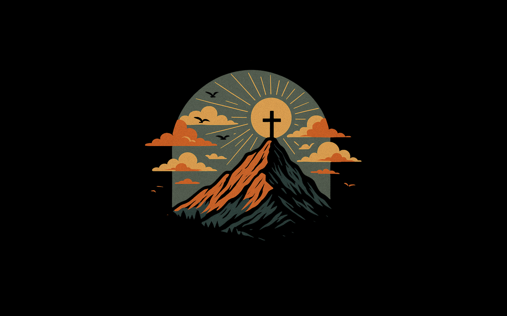

# Cross Mountain

An Omarchy theme built around a vintage-style illustration of a cross on a mountain peak against a sunburst sky. The palette pulls from the artwork: sage sky, burnt-orange clouds, golden sun and deep pine shadows, set on black.



## Install

```bash
omarchy theme install https://github.com/OutOfTheWhale/omarchy-cross-mountain-theme
```

## Palette

| Role | Color |
|---|---|
| Accent | `#e3a955` |
| Orange / red | `#d9823f` / `#c9652a` |
| Sage | `#8a9a78` |
| Pine | `#2c3a33` |
| Background | `#0c0d0b` |
| Foreground | `#e6d6b8` |
